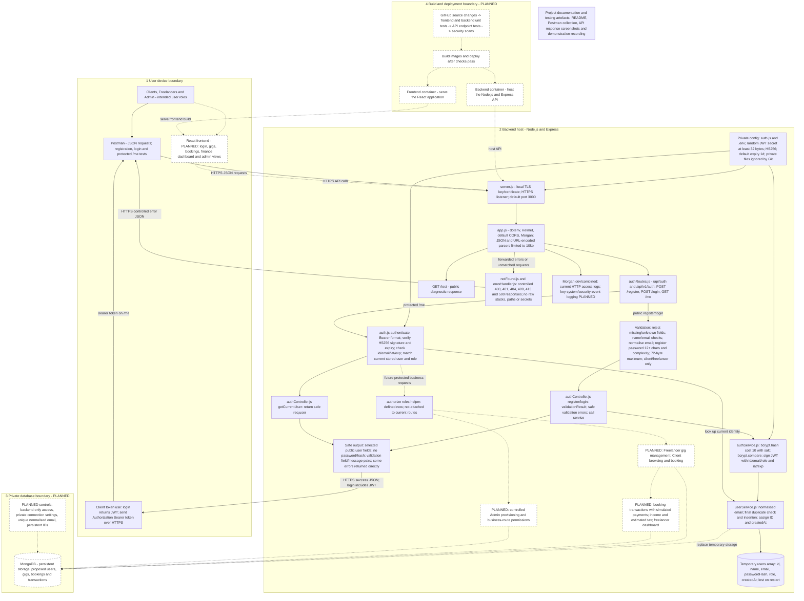

# HustleHub+

## 1. Introduction

HustleHub+ is a freelance marketplace designed to allow freelancers to advertise services and clients to browse and book them. The completed system will allow freelancers to advertise services and clients to browse and book them. It will also record simulated payments and help freelancers view their income and estimated tax.

The current implementation focuses on the backend foundation needed for secure registration and login. The current code uses Node.js and Express, stores password hashes with bcrypt, and uses JSON Web Tokens (JWTs) for authenticated requests. It also includes input validation, local HTTPS and controlled error responses.

User details are stored temporarily in an array. This is permitted for Part 1, but records are lost when the server restarts. React, MongoDB and the marketplace features are planned for future development.

## 2. Intended users

| User | Purpose in the completed system | Current support |
| --- | --- | --- |
| Client | Browse services and make bookings | Registration, login and access to their own profile |
| Freelancer | Manage services and view financial information | Registration, login and access to their own profile |
| Admin | Manage the platform and user access | Planned; public registration rejects the admin role |

Registration accepts `client` or `freelancer`. If no role is supplied, the account becomes a client. A reusable role-checking function exists, but no current route uses it.

## 3. System architecture

The design follows MERN: MongoDB, Express, React and Node.js. Express provides the API, and Node.js runs the backend. React will provide the user interface, while MongoDB will provide permanent storage. Postman is used to send and test API requests.



*Figure 1: Full HustleHub+ system architecture. Dashed connections show planned work. The diagram includes the current authentication backend, the intended marketplace and the future build and deployment process. Responses return through the same HTTPS connection.*

The diagram shows four system boundaries. The **user device** is outside the backend's control, so incoming data must be checked. The **backend server** handles requests and holds the private JWT secret and local TLS key. The **planned database** will be accessed through the backend rather than directly from a browser. The **planned build and deployment boundary** contains the testing pipeline and the frontend and backend containers.

A user could bypass a future React form and send a request directly. Validation and authentication must therefore take place on the server.

## 4. Backend structure

```text
server.js
package.json
.env.example
.gitignore
HustleHub API Tests.postman_collection.json
src/
  app.js
  config/auth.js
  routes/authRoutes.js
  controllers/authController.js
  services/authService.js
  services/userService.js
  middleware/auth.js
  middleware/notFound.js
  middleware/errorHandler.js
```

| File | Purpose |
| --- | --- |
| `server.js` | Reads the TLS key and certificate and starts HTTPS |
| `src/app.js` | Loads settings, adds middleware and connects routes |
| `src/config/auth.js` | Checks the JWT secret and expiry setting and defines the signing algorithm |
| `src/routes/authRoutes.js` | Defines routes and their validation or authentication requirements |
| `src/controllers/authController.js` | Checks validation results, calls services and sends HTTP responses |
| `src/services/authService.js` | Handles registration, password comparison and JWT generation |
| `src/services/userService.js` | Stores users, normalises emails and prevents duplicate accounts |
| `src/middleware/auth.js` | Checks tokens and provides a role-checking function |
| `src/middleware/notFound.js` | Passes unmatched requests to the error handler as 404 errors |
| `src/middleware/errorHandler.js` | Returns approved messages instead of internal error details |

The files are separated by their responsibilities. This makes the code easier to follow and should help when temporary storage is replaced with MongoDB. There is no database model in the current version.

Express provides the API, bcrypt handles passwords, jsonwebtoken handles tokens, and express-validator checks input. Helmet adds security-related response headers, CORS supports browser cross-origin requests, Morgan logs requests, and dotenv loads environment variables. Nodemon restarts the server during development.

## 5. Request flow

### Registration

1. The client sends a registration request over HTTPS.
2. Express reads the body, and the route validates the fields.
3. The controller returns validation errors or calls the authentication service.
4. The service checks the email and hashes the password.
5. The storage service checks for duplicates again and creates the record.
6. The controller returns `201 Created` with public user details.

The second duplicate check matters because hashing is asynchronous. Two requests could pass the first check before either stores its user. The final check and insertion run together without an asynchronous pause in this single-process store. MongoDB will later need a unique email constraint.

### Login and protected access

The login route validates the email and password. The service finds the user and compares the password with the stored hash. If they match, it returns a signed JWT and a limited user object.

For `/me`, the client sends `Authorization: Bearer <token>`. The authentication middleware verifies the token and finds the matching current user. It places safe user details in `req.user`, which the controller returns. This check runs on every request to `/me`.

## 6. Security decisions

### Password hashing

Registration uses `bcrypt.hash(password, 10)`. bcrypt creates a salt and hash so that the original password does not need to be stored. The value `10` is the cost factor, which controls the work involved. Login uses `bcrypt.compare` to check a submitted password against the hash (bcrypt, n.d.).

The stored user contains `passwordHash`. Successful responses exclude passwords and hashes. Passwords above 72 UTF-8 bytes are rejected because bcrypt would ignore the extra bytes. Passwords are not trimmed or changed to lowercase.

### JWT authentication

The token contains `id`, `email` and `role`. The JWT library adds the issue and expiry times. Tokens use `HS256`, with a default lifetime of one day. The same private secret is used for signing and verification.

A signed JWT can still be read; its payload is not encrypted. It must not contain a password. The backend verifies the signature and expiry rather than simply reading the contents (Auth0, n.d.). It also checks the required claim types and matches the token ID to the stored user. The current role is taken from storage.

Startup is refused if the JWT secret is missing, too short or equal to the example placeholder. The actual secret must be randomly generated, since length alone does not make it secure. Expiry requires a unit, such as `1h` or `1d`.

### Input validation

Registration only accepts `name`, `email`, `password` and `role`. Login only accepts `email` and `password`. Unknown fields and unsuitable body types are rejected.

| Field | Registration rules |
| --- | --- |
| Name | String, trimmed, 2–100 characters; letters, combining marks, spaces, apostrophes and hyphens are allowed; at least one letter is required |
| Email | Valid email string, trimmed and lowercased |
| Password | At least 12 characters, no more than 72 UTF-8 bytes, with uppercase, lowercase, a number and a symbol |
| Role | Optional; only `client` or `freelancer` |

Login requires a valid email and a nonempty password within the byte limit. It checks the existing credential rather than repeating all registration password rules. Validation responses contain field names and messages without echoing submitted passwords.

### HTTPS and error handling

`server.js` uses `https.createServer` with a local TLS key and certificate. HTTPS protects passwords and tokens while they travel between the client and server (Node.js, n.d.). Hashing protects the stored password verifier, so both controls are needed.

The testing client must trust the local certificate correctly. Turning off certificate verification does not verify the server's identity. The TLS private key and JWT secret must remain outside the repository and recording.

The error handler returns approved messages instead of stack traces or internal paths. For example, an unknown route returns `Resource not found`. Unexpected errors receive a generic server message.

JSON and URL-encoded bodies have a `10kb` limit. Helmet adds response headers, and Morgan logs HTTP requests. The current CORS setting allows broad cross-origin access; it is not an authentication check. The `authorize` function can check roles, but no existing route uses it.

## 7. Local setup

Use the backend checkout containing `package.json` and `server.js`. Ensure you are working from the correct project branch containing the backend implementation. The `main` branch may contain starter or earlier project files.

1. Install a supported Node.js LTS release with npm, Postman Desktop and OpenSSL 3.
2. Run `npm install` in the backend directory.
3. For a new setup, copy `.env.example` to `.env`. Preserve any existing private configuration. Use:

   ```dotenv
   PORT=3000
   NODE_ENV=development
   JWT_SECRET=replace_with_a_long_random_secret
   JWT_EXPIRES_IN=1d
   ```

   Replace the placeholder with a random private value. Generate one locally before recording, and keep the output private:

   ```powershell
   node -e "console.log(require('crypto').randomBytes(32).toString('hex'))"
   ```

4. Supply `src/certificates/server.key` and `src/certificates/server.cert`. If neither exists, create a local development pair with:

   ```powershell
   New-Item -ItemType Directory -Path src/certificates -Force
   openssl req -x509 -newkey rsa:2048 -noenc -sha256 -days 365 -keyout src/certificates/server.key -out src/certificates/server.cert -subj "/CN=localhost" -addext "subjectAltName=DNS:localhost,IP:127.0.0.1"
   ```

   Do not overwrite a working pair. Configure Postman's certificate trust for the local certificate. The OpenSSL and Postman references below explain these settings.

5. Run `npm start` and use `https://localhost:3000`. Use `npm run dev` during development.

Keep the process running between registration and login. Missing JWT settings or TLS files prevent startup. Private environment files, certificates and dependencies are excluded from Git. The source also excludes `package-lock.json`, so it does not lock every dependency version.

## 8. API endpoints

Use raw JSON and `Content-Type: application/json` for POST requests.

| Method | Path | Access | Expected success |
| --- | --- | --- | --- |
| GET | `/test` | Public | 200 with a server message |
| POST | `/api/v1/auth/register` | Public | 201 with public user details |
| POST | `/api/v1/auth/login` | Public | 200 with a JWT and public user details |
| GET | `/api/v1/auth/me` | Bearer token required | 200 with the current profile |

The authentication routes also work under `/api/auth`. Registration creates an account; login generates the token.

### Registration example

Send to `https://localhost:3000/api/v1/auth/register`:

```json
{
  "name": "Jane Demo",
  "email": "jane.demo@example.com",
  "password": "DemoPass12345!",
  "role": "freelancer"
}
```

Expect `201`, with `status: "success"` and `data.user` containing `id`, `name`, `email`, `role` and `createdAt`. IDs and timestamps depend on the running process.

### Login example

Send to `https://localhost:3000/api/v1/auth/login`:

```json
{
  "email": "jane.demo@example.com",
  "password": "DemoPass12345!"
}
```

Expect `200`, with a token in `data.token`. The login user object contains `id`, `email` and `role`. For `/me`, send:

```http
Authorization: Bearer <token returned by login>
```

### Common errors

| Scenario | Status | Response |
| --- | --- | --- |
| Invalid or missing field | 400 | An `errors` array with validation messages |
| Valid duplicate registration | 409 | `User with this email already exists` |
| Wrong password or unknown email | 401 | `Invalid email or password` |
| Missing, invalid or expired token | 401 | `Unauthorized: Invalid or missing token` |
| Unknown route | 404 | `Resource not found` |
| Malformed JSON | 400 | `Invalid input data` |
| Oversized body | 413 | `Request body is too large` |

Validation errors use an `errors` array. Other handled errors normally use `status` and `message`, while successful authentication uses `status` and `data`. The formats are therefore not completely uniform.

## 9. Postman testing and demonstration

Two collections exist in this project.

The recorded demonstration therefore uses a second collection, **HustleHub+ Part 1 — video demo**, containing 14 requests labelled A to N with 42 assertions. Running it with the Collection Runner against a freshly started server produced **42 passed, 0 failed and 0 errors**, with a total duration of 2.62 s and an average response time of 55 ms. Screenshots of that run are provided in Section 10.

Each request stays close to a single variable: one field is changed at a time so that a failure can be attributed to a specific rule. Registration in request B stores the account that requests C, D, F and G then depend on, so the collection is run in order against a server that has just been started. Because storage is in memory (Section 11), running the collection twice without restarting the server causes request B to return 409 instead of 201, since the account from the first run still exists.

| Request | Purpose | Recorded result | Figure |
| --- | --- | --- | --- |
| A | Health check over HTTPS | 200 with a server message | 2, 4 |
| B | Register a valid user | 201, no password or hash in the response | 3, 5 |
| C | Log in with that account | 200 with a three-part JWT | 6, 7 |
| D | Request `/me` with the token | 200 with the current profile | 8 |
| E | Request `/me` with no token | 401 | 9 |
| F | Repeat the registration | 409 | 10, 11 |
| G | Log in with the wrong password | 401 | 12, 13 |
| H | Register with a 7-character password | 400 identifying the password field | 14, 15 |
| J | Request the `admin` role | 400 | 16, 17 |
| K | Register with an invalid email | 400 | 18, 19 |
| L | Log in without a password field | 400 | 20, 21 |
| M | Send malformed JSON | 400 | 22, 23 |
| N | Request an unknown URL | 404 | Not captured |

Requests I is skipped in the labelling to avoid confusion with the digit 1. Request N was executed as part of the run but was not captured as a separate screenshot.

The demonstration video shows the running API, successful registration, and login with token generation, followed by the protected `/me` request. Disposable demonstration credentials are used throughout, and the JWT shown in the recording is abbreviated.

The Postman collection used for testing can be maintained alongside this README for reproducibility and future regression testing.

## 10. API response screenshots

The screenshots below were captured from the **HustleHub+ Part 1 — video demo** collection run described in Section 9. Each figure shows the request name, the endpoint, the HTTP status code and the response or request body. The Collection Runner header in the wider screenshots shows the run totals (42 assertions, 42 passed, 0 failed, 0 errors), which confirms that each individual result comes from the same single run rather than from separate attempts.

Image files are stored in the `screenshots/` directory of this repository.

### Successful paths


*Figure 2: `GET /test` returns 200 with `{"message": "Server is working!"}`. The request was sent over HTTPS to `https://localhost:3000`, confirming that the TLS listener created in `server.js` is running.*


*Figure 3: The same health check shown in the Collection Runner, with the assertions HTTP 200, JSON response and No internal details all passing.*


*Figure 4: `POST /api/auth/register` returns 201. The response contains only `id`, `name`, `email`, `role` and `createdAt`. No password or password hash appears, which demonstrates the public-field allowlist described in Section 6.*


*Figure 5: The registration response in detail, showing the created account for `jane.demo@example.com` with the role `freelancer` and a server-assigned `id` and `createdAt`. No token is issued at registration; a token is generated only at login.*


*Figure 6: `POST /api/auth/login` returns 200. The Three-part JWT assertion confirms that the response contains a correctly formed token.*


*Figure 7: The login response in detail. The token is returned in `data.token` alongside a limited user object containing only `id`, `email` and `role`.*


*Figure 8: `GET /api/auth/me` returns 200 when the token from Figure 7 is supplied in the `Authorization: Bearer` header. No password is sent with this request; the token alone establishes the identity, and the response contains safe profile fields only.*

### Rejected requests


*Figure 9: `GET /api/auth/me` without an `Authorization` header returns 401 with `Unauthorized: Invalid or missing token`. Authentication stops the request before the profile controller runs, so no user details are returned even though the route address is known.*


*Figure 10: Repeating the registration from Figure 4 with the same email returns 409. The request is valid in format, so this is a business rule enforced in the service layer rather than a field-validation failure.*


*Figure 11: The duplicate-registration response in detail, returning the approved message `User with this email already exists`. A second account is not created.*


*Figure 12: Logging in with the correct email but an incorrect password returns 401 and no token.*


*Figure 13: The response message is the generic `Invalid email or password`. This is deliberately identical to the message returned for an unknown email, so the endpoint cannot be used to confirm which email addresses are registered.*


*Figure 14: Registration with a 7-character password returns 400. Validation rejects the request before it reaches hashing or storage.*


*Figure 15: The submitted body for Figure 14. The password `Short1!` contains uppercase, lowercase, a number and a symbol, but fails the 12-character minimum, showing that the length rule is applied independently of the complexity rules.*


*Figure 16: Registration requesting `"role": "admin"` returns 400. The role allowlist accepts only `client` and `freelancer`, so a caller cannot grant themselves administrative access by editing the request body.*


*Figure 17: The rejected admin-role request in detail, showing the validation message returned for the `role` field.*


*Figure 18: Registration with a malformed email address returns 400 from the email validator.*


*Figure 19: The invalid-email response in detail. The validation error identifies the field and the reason without echoing the submitted password.*


*Figure 20: A login request with no `password` field returns 400 rather than 401, because the request fails validation before any credential comparison takes place.*


*Figure 21: The missing-password response in detail, showing the `errors` array format used for validation failures.*


*Figure 22: A request body containing malformed JSON returns a controlled 400 rather than a parser error.*


*Figure 23: The truncated body that produced Figure 22. The response contains no stack trace, no file path and no fragment of the submitted body, which is the behaviour described in Section 6.*

Taken together, Figures 2 to 8 demonstrate the required registration and login flow with token generation, and Figures 9 to 23 demonstrate that invalid, malicious and malformed input is rejected with controlled responses.

## 11. Limitations and future development

The current user array is temporary and is not shared between processes. React, MongoDB, marketplace features and administrator features remain planned future work. There are currently no refresh tokens, logout functionality or token revocation mechanisms.

The backend does not yet include a complete automated test suite, containerised deployment or a full CI/CD pipeline. These areas can be expanded as the project develops.

## 12. Team contributions

The project was completed collaboratively, with team members contributing to different areas of the backend, security implementation, testing and documentation.

| Team member | Contribution |
| --- | --- |
| Matthew Jackson | Project documentation, architecture, API testing and backend contribution |
| Team Member 2 | Authentication and security implementation |
| Team Member 3 | Backend development, integration and testing |

*Update the names and contribution descriptions above to reflect the final verified responsibilities of each team member.*

## 13. AI declaration

Generative AI tools were used as a supporting aid for documentation, formatting and code-related guidance, with all generated content reviewed, verified and adapted by the project team.

## References

Auth0 (n.d.) *[node-jsonwebtoken](https://github.com/auth0/node-jsonwebtoken)*. Accessed 6 September 2026.

bcrypt (n.d.) *[bcrypt for Node.js](https://github.com/kelektiv/node.bcrypt.js/)*. Accessed 6 September 2026.

Node.js (n.d.) *[HTTPS documentation](https://nodejs.org/api/https.html)*. Accessed 6 September 2026.

OpenSSL (n.d.) *[openssl-req](https://docs.openssl.org/3.5/man1/openssl-req/)*. Accessed 6 September 2026.

Postman (n.d.) *[Certificate settings](https://learning.postman.com/docs/getting-started/installation/settings/certificates)*. Accessed 6 September 2026.